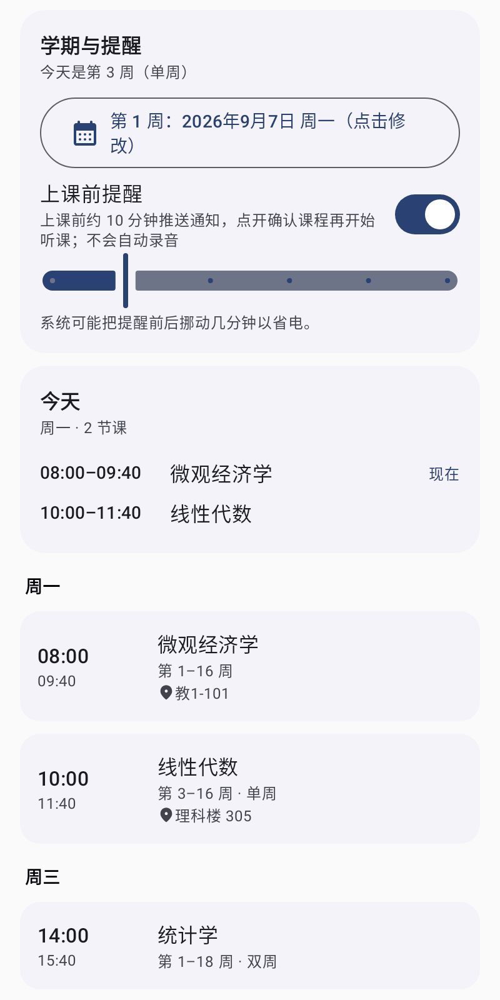
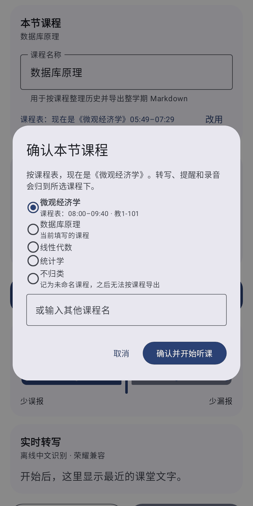
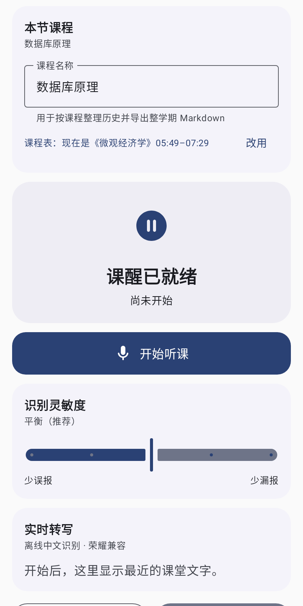
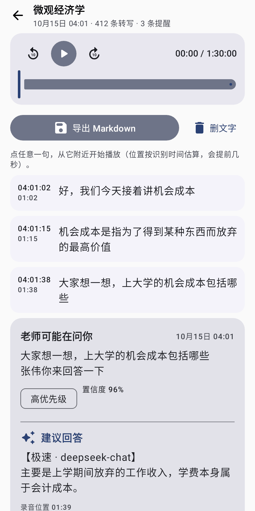

<div align="center">
  
  <h1>ClassCue (课醒)</h1>
  <p><strong>Keeps every lesson on your timetable, and wakes you up when you're called on.</strong></p>
  <p>A local-first Android class companion: timetable · offline recording and transcription · name-call and question alerts · replay and search after class · optional AI answers</p>

  <p>
    <a href="https://github.com/lu0973-cb02d/ClassCue/releases/latest"></a>
    
    
    <a href="LICENSE"></a>
  </p>
  <p>
    <a href="README.md">简体中文</a> · <strong>English</strong>
  </p>
</div>

ClassCue follows a lesson from start to finish. Before class, it uses your timetable to confirm which course is starting. During class, it records and transcribes on the phone, offline, and alerts you the moment the teacher appears to call your name or ask a question. After class, you can replay the recording by course, search what was said, and export notes. Recordings and transcripts stay on your phone; only if you configure and enable AI is the relevant piece of text sent to model services you choose.

<table>
  <tr>
    <td align="center" width="25%"><br><sub>Timetable and this week</sub></td>
    <td align="center" width="25%"><br><sub>Confirm the course</sub></td>
    <td align="center" width="25%"><br><sub>Listening and live transcript</sub></td>
    <td align="center" width="25%"><br><sub>Replay and alerts after class</sub></td>
  </tr>
</table>

The screenshots show the Chinese UI, which is currently the only language.

## What ClassCue does during a lesson

### Before class

- **Timetable**: enter courses by weekday, start and end time, week range, and odd/even weeks, with an optional location. Set the first week of the semester and ClassCue works out the current week.
- **Class reminders (optional)**: a notification shortly before class opens the course confirmation. Reminders only notify; they **never start recording on their own**.

### During class

- **Confirm the course**: when you tap Start, the course that is on now or about to start is preselected; you can pick another or type one in. The recording, transcript, and alerts are filed under that course.
- **Offline recording and transcription**: one microphone stream is written to a local WAV file and fed to an on-device recognizer. Three model tiers are available, with far-field enhancement, external microphone support, and a power-saving mode.
- **Name-call and question alerts**: student numbers, names, forms of address, name-call phrases, and question phrases are scored together; names misrecognized as same- or similar-sounding characters are still matched. Both "question, then name" and "name, then question" are linked to their context (30–120 seconds each way, adjustable). A high-priority notification shows the teacher's words first and adds the AI answer when it arrives. Sensitivity ranges from "fewer false alerts" to "fewer misses".
- **AI answers (optional)**: the text around an alert is sent in parallel to one or more models you configure, and the answer streams into the same notification. By default only questions directed at you trigger automatic requests, capped per 10 minutes; you can also select the teacher's words by hand and resend.
- **Huawei watch (self-signed build required)**: `wearable/KexingWatchCue` contains the watch app source, which can mirror alerts and answers on the watch.

### After class

- **Lesson detail**: a timeline of transcript, alerts, and AI answers with a built-in player; tap any line to play the recording from around that point.
- **Full-text search** across courses for the teacher's words, alerts, and answers.
- **Export** one lesson, one course, or everything to Markdown.
- **Space and safety**: finished recordings can be compressed to AAC in the background (about 14 MB per hour versus about 110 MB for WAV), keeping the original by default. If the app is killed or the phone restarts, the unfinished recording is repaired instead of lost.

## Download and install

Download `ClassCue-<version>-arm64-v8a.apk` from [Releases](https://github.com/lu0973-cb02d/ClassCue/releases/latest) and check it against `SHA256SUMS.txt` from the same release.

| Item | Requirement / note |
|---|---|
| System | Android 13–16, `arm64-v8a` |
| Package name | `com.classcue.kexing.github` (since 0.2.8) |
| First launch | Allow microphone and notification permissions |
| Upgrading from 0.2.6 or earlier | Those builds used `com.classcue.kexing.debug`, so the new version installs as a separate app. Export anything you want to keep from the old app's History first, then uninstall it once the new one works |

Changes in each version are listed in [`release-notes/`](release-notes) (Chinese).

## Getting started

1. **Timetable**: set the Monday of the first semester week and add your courses. You can skip this and type a course name on the Listen screen instead.
2. **Settings**: enter the names, student number, and forms of address you may be called by (separate entries with commas, semicolons, or new lines), plus any high-priority keywords.
3. **Settings**: choose a recognition model. The small tier is bundled; medium and large are downloaded in the app.
4. For AI answers, add at least one HTTPS BaseURL, model name, and API key, and assign the Fast or Thorough role.
5. On **Listen**, tap Start and confirm the course. "Test alert" checks that notifications and vibration work.
6. After class, replay, search, or export from **History**.

With a USB, Bluetooth, or wired microphone, set the input strategy to External. Classroom far-field enhancement, on by default, only affects the audio sent to the recognizer, never the saved recording.

## Offline recognition models

| Tier | Best for | Delivery | Download size |
|---|---|---|---:|
| Small | Limited storage and fast start; automatic fallback when medium or large cannot load | Bundled Vosk small Chinese model | None |
| Medium | More stable streaming transcription | In-app download of sherpa-onnx Zipformer INT8 | About 127 MiB |
| Large | A second, more accurate pass after streaming | In-app download of sherpa-onnx Zipformer CTC INT8 (requires medium) | About 288 MiB |

- Downloads run in a foreground service with progress, pause, resume, retry, and delete.
- Choose the official GitHub Release or the `hf-mirror.com` mirror for mainland China; if the preferred source fails, the other is tried.
- The exact size and SHA-256 of every model file are pinned in the client (`OfflineModelCatalog.kt`). Both sources are checked against the same values, and a mismatching file is deleted rather than installed.

## Configuring AI services

A practical setup is one low-latency model and one more capable model:

| Role | Suggested timeout | Behavior |
|---|---:|---|
| Fast | 5–15 seconds | The first answer updates the notification immediately |
| Thorough | 25–45 seconds | Updates the same notification later and is shown first |

Services must be compatible with OpenAI Chat Completions, and the BaseURL must use HTTPS. `https://example.com` and `https://example.com/v1` are completed to `/v1/chat/completions`; an address that already ends in `/chat/completions` is used as is. Each model keeps its own address, model name, role, key, timeout, and enabled state, and one failing service does not block the others.

## Privacy and data

| Data | Where it goes |
|---|---|
| Raw recording | A local WAV file (optionally compressed to AAC on the device), kept until you delete it; never sent to AI services |
| Far-field enhanced audio | Used in memory by the recognizer only; neither stored nor uploaded |
| Transcripts, alerts, AI answers | Local SQLite, organized by course and lesson, kept until you delete them |
| Timetable | Stored only on the phone; reminders are fired locally by the system alarm service |
| AI API keys | Local storage encrypted with Android Keystore |
| Text sent to AI | Only the text around an alert, only to HTTPS services you configured |
| System backup | Recordings, key configuration, and the lesson history database are excluded from cloud backup and device transfer |
| Medium and large models | Downloaded from official `k2-fsa/sherpa-onnx` Releases or `hf-mirror.com` and checked against pinned SHA-256 values before installation |

ClassCue does not use text-to-speech and never uploads raw recordings. Obtain any required consent before recording and follow school rules and local law; do not use it during exams or where electronic devices are prohibited. Never attach real recordings, transcripts, API keys, or other personal information to a public issue; see [SECURITY.md](SECURITY.md) for security reports.

## Known limitations

- Distance, echo, overlapping speakers, accents, and uncommon names all affect recognition. Software gain cannot recover speech the microphone never captured; move the phone closer or use an external microphone near the teacher. The project does not claim 100% accuracy.
- The timetable is entered by hand; importing from school systems is not supported yet.
- Compression and class reminders have not yet been verified over long periods on real devices; reminders use inexact alarms that the system may shift by a few minutes to save power.
- Foreground services and a wake lock improve reliability but cannot bypass force-stop, the microphone privacy switch, or aggressive vendor battery management. Whether MagicOS shows the ongoing notification as a Live Capsule is up to the system.
- The UI is Chinese-only, and only `arm64-v8a` is built.
- The watch pairs only with the formally signed `com.classcue.kexing`. Building the watch HAP requires Huawei DevEco/Hvigor, your own signing certificate and profile, and a real watch; none of these are in the public repository.

## Building from source

| Component | Requirement |
|---|---|
| JDK | 17 |
| Android SDK / Build Tools | 36 / 36.0.0 |
| Android Studio | 2025.2.2 or compatible |

```bash
git clone https://github.com/lu0973-cb02d/ClassCue.git
cd ClassCue
./gradlew testDebugUnitTest lintDebug assembleDebug
```

Use `gradlew.bat` on Windows. If Google Maven is unreliable in mainland China, set `$env:KEXING_MAVEN_PROXY = "https://maven.aliyun.com/repository"` first.

| Build type | Command | Application ID | Notes |
|---|---|---|---|
| `debug` | `assembleDebug` | `com.classcue.kexing.debug` | Local development, debuggable |
| `github` | `assembleGithub` | `com.classcue.kexing.github` | The optimized public build used for Releases |
| `release` | `assembleRelease` | `com.classcue.kexing` | Requires your own signing certificate; see [FORMAL_SIGNING_REQUIRED.md](FORMAL_SIGNING_REQUIRED.md) |

The three build types have different IDs and install side by side. APKs are written to `app/build/outputs/apk/<build type>/`. On every push to `main`, GitHub Actions runs the tests and Lint, builds the `github` variant, and publishes a Release when a matching `release-notes/v<version>.md` exists. Current test and Lint results are in [BUILD_STATUS.md](BUILD_STATUS.md).

## Project structure

```text
ClassCue/
├─ app/src/main/java/com/classcue/kexing/
│  ├─ data/       # Lesson history database, recording files, timetable, settings, and secrets
│  ├─ engine/     # Recording, offline ASR, cue scoring, class reminders, model downloads, AI requests
│  ├─ model/      # Settings, timetable, and lesson data models
│  └─ ui/         # Jetpack Compose screens: Listen, Timetable, History, Settings
├─ app/src/main/assets/vosk-model-small-cn-0.22/  # Bundled small model
├─ app/src/test/                # Unit and screenshot tests
├─ wearable/KexingWatchCue/     # Huawei Lite Wearable watch source
├─ release-notes/               # Per-version notes (CI publishes from these)
├─ docs/screenshots/            # README screenshots
└─ LICENSES/                    # Copies of third-party licenses
```

## Contributing

Reproducible bug reports, suggestions, and pull requests are welcome. Before submitting, run at least:

```bash
./gradlew testDebugUnitTest lintDebug assembleDebug
```

Do not commit keys, certificates, real classroom recordings, personal transcripts, or model service credentials.

## License

ClassCue's own source code and documentation are released under the [MIT License](LICENSE). Vosk, sherpa-onnx, AndroidX, Jetpack Compose, JNA, Apache Commons, pretrained models, and other third-party components remain under their own licenses; see [THIRD_PARTY_NOTICES.md](THIRD_PARTY_NOTICES.md) and [LICENSES/](LICENSES).
